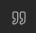
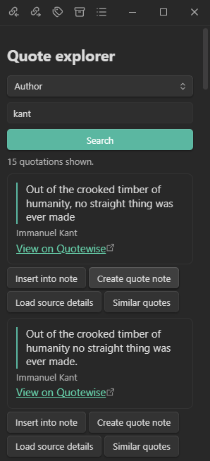
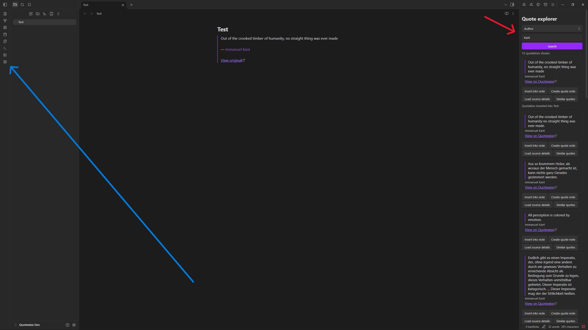

# Quotewise for Obsidian

Discover quotations, check their attribution, and save them to your notes. An independent integration with Quotewise.

## Install

1. Download `main.js`, `manifest.json`, and `styles.css` from the [latest release](https://github.com/AriyanBe/quotewise-obsidian/releases/latest).
2. Put the three files in `<your vault>/.obsidian/plugins/quotewise-obsidian/`. Create the folder if needed.
3. Reload Obsidian **1.11.4 or later**, then enable **Quotewise** under **Settings → Community plugins**.
4. For wording and topic searches, similar quotes, and source details, create a key in the [Quotewise developer dashboard](https://quotewise.io/developers/dashboard/). Save it under **Settings → Quotewise** and select **Test connection**. Author search and attribution also work anonymously, subject to Quotewise's quota.

## Use

1. **Open the explorer.** Select the quote icon  in the left ribbon, or run **Quotewise: Open quote explorer** from the command palette.
2. **Find a quote.** Choose **Words or exact phrase**, **Meaning or topic**, or **Author**. Enter your search and select **Search**. Select **Load source details** to see available citations, or **Similar quotes** to keep exploring.

   

3. **Save a quote.** Open a note in editing mode, place the cursor where you want the quote, then select **Insert into note**. Select **Create quote note** to save it separately. Set your preferred insertion format and destination folder under **Settings → Quotewise**.

   

4. **Check attribution.** Select quotation text in a note, run **Quotewise: Check quotation attribution**, and select **Check with Quotewise**. Review the matches, corrections, and source evidence when available.

Searches, source lookups, and confirmed attribution checks send your query, quote reference, or selected text to Quotewise. Saving quotes is a local vault action.
